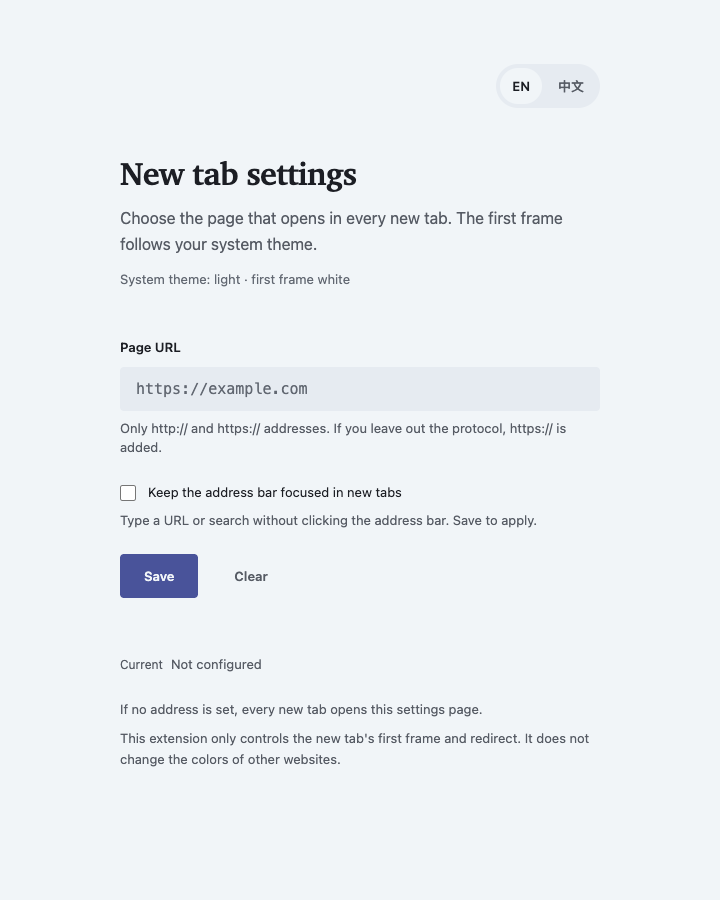
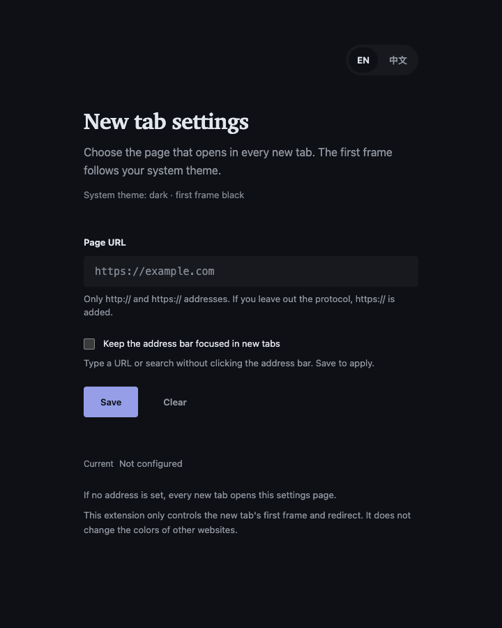
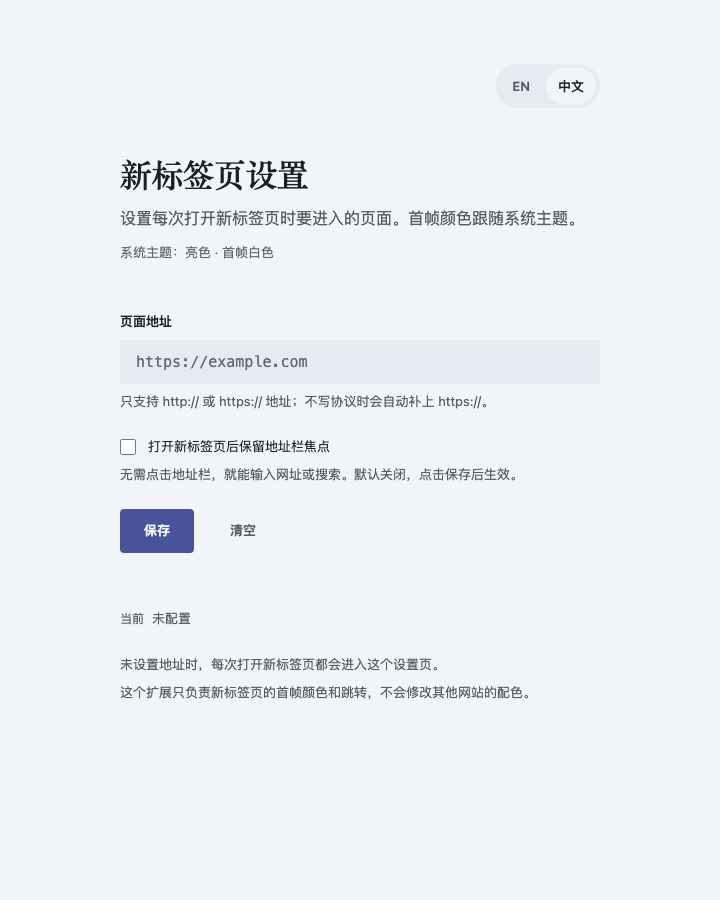
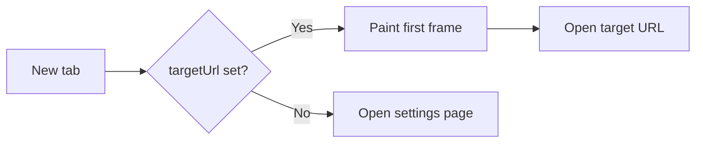

<!-- prettier-ignore -->
<div align="center">

<picture>
  <source media="(prefers-color-scheme: dark)" srcset="docs/cover-dark.png">
  
</picture>

<p>A small Chrome extension that opens a page of your choice in every new tab.<br>一个可配置目标网址的 Chrome 新标签页扩展，支持亮/暗首帧与中英文设置页。</p>


[功能](#功能) • [演示](#演示) • [截图](#截图) • [安装](#安装) • [使用](#使用) • [工作原理](#工作原理) • [隐私与权限](#隐私与权限) • [开发](#开发)

</div>

## 它是什么

Custom New Tab 只做一件事：把新标签页变成你指定的网页。它不提供仪表盘、新闻流、快捷方式或搜索框，也不会修改其他网站的配色。

很多新标签页扩展会顺带接管整个起始页；这个扩展刻意保持小：一个目标地址、一个地址栏焦点开关、一个语言选择、一个跟随系统的首帧颜色。没有构建步骤，没有第三方依赖，只申请 `storage` 权限。

## 功能

- **可配置目标地址**：支持 `http://` / `https://`，不写协议自动补 `https://`，也接受 `localhost:3000` 这类 host:port 写法；`javascript:`、`ftp://`、`mailto:` 会被拒绝。
- **跟随系统的首帧**：系统亮色时新标签页先显示白色，暗色时先显示黑色，然后才跳转；重定向页本身不会闪出相反的颜色。
- **可选的地址栏焦点**：勾选后，新标签页跳转完成时地址栏仍然握着焦点，直接输入网址或搜索，不用先点一下地址栏。默认关闭。
- **默认留空**：首次安装自动打开设置页；没有配置地址时，新标签页也会进入设置页，不会跳到某个预设站点。
- **中英文设置页**：默认英文，右上角可切换中文；语言选择会记住。
- **极简权限**：只申请 `storage`；没有 host permissions、content scripts、分析或远程代码。
- **无构建步骤**：原生 HTML/CSS/JS，加载已解压扩展即可运行。
- **克制的界面**：Atelier 风格的冷纸色、单一靛蓝 accent、Charter/Songti 标题、4pt 间距；无卡片、无边框、无阴影，焦点和错误态只用 outline。

## 演示

<p align="center">
  
</p>

<p align="center"><sub>演示了输入地址、保存、切换中文、切换暗色和清空。</sub></p>

## 截图

<p align="center">
  
  
</p>

<p align="center"><sub>亮色与暗色。设置页跟随系统主题。</sub></p>

<details>
<summary>中文界面</summary>
<br>
<p align="center">
  
</p>
<p align="center"><sub>默认英文，右上角切换到中文。</sub></p>
</details>

## 安装

> [!NOTE]
> 目前是本地未打包扩展，尚未上架 Chrome Web Store。

如果你还没有代码，先克隆仓库：

```bash
git clone https://github.com/hey-yx/chrome-newtab-redirect.git
```

1. 打开 `chrome://extensions`。
2. 打开右上角的 **开发者模式**。
3. 点击 **加载已解压的扩展程序**，选择本项目目录。
4. 停用其他会覆盖新标签页的扩展，避免多个扩展同时抢占新标签页。
5. 打开一个新标签页。因为地址默认是空的，设置页会自动打开。

> [!TIP]
> 把扩展图标固定到工具栏，之后点一下就能打开设置页。

## 使用

点击工具栏图标，或从 `chrome://extensions` → 本扩展「详情」→「扩展程序选项」打开设置页。

- **Page URL / 页面地址**：填写要打开的新标签页地址。保存后，下次打开新标签页生效。
- **Save / 保存**：保存地址。只接受 `http://` 或 `https://`；不写协议会自动补 `https://`。
- **Keep the address bar focused in new tabs / 打开新标签页后保留地址栏焦点**：勾选后，新标签页跳转完成时地址栏保持焦点，可以直接打字。它跟地址一起保存，清空地址不会关掉它。
- **Clear / 清空**：移除地址。之后每次打开新标签页都会回到设置页，直到重新填写。
- **EN / 中文**：切换界面语言，选择会保存。

> [!IMPORTANT]
> 地址为空时，新标签页会打开设置页，而不是某个默认网站。

## 工作原理



- `redirect.html` 在页面最前面用 `prefers-color-scheme` 决定首帧是白色还是黑色，此时还没有任何外部内容。
- `redirect.js` 从 `chrome.storage.local` 读取 `targetUrl` 和 `focusAddressBar`；地址为空或无效时打开 `options.html`。
- 跳转有两种走法。开关关闭时用 `location.replace`，历史记录里只留目标页。开关打开时改用 `chrome.tabs.update` 让浏览器发起导航，页面没法把焦点从地址栏抢走，代价是这个新标签页的历史里会多出一条跳转页，在第一个页面按后退会重新加载一次目标页。
- `background.js` 在首次安装时打开设置页，并处理工具栏图标的点击。
- `options.html` / `options.css` / `options.js` 是设置页：地址校验、保存、清空、中英文切换。
- 扩展本身不发起任何网络请求；唯一的网络流量是你配置的目标地址导航。

## 隐私与权限

- **`storage`**：保存目标地址、界面语言和地址栏焦点开关到 `chrome.storage.local`，仅此而已。
- 当前使用 `chrome.storage.local`，不经过 Chrome Sync。
- 没有 host permissions、content scripts、分析、追踪或远程代码。
- 扩展不读取网页内容，也不修改其他网站。
- 目标地址只在你打开新标签页时用于导航；扩展不会把地址发送到任何第三方服务。
- 如果地址里包含敏感查询参数，请记住它保存在本机 Chrome 配置里；不要把含密钥的地址分享给他人。

## 设计

设置页使用一套克制的编辑型视觉：冷纸色、单一靛蓝 accent、Charter/Songti 标题、系统/PingFang 正文、SF Mono 显示 URL、4pt 间距。没有卡片、边框或阴影；只有键盘焦点和错误态使用 outline。亮/暗两套 token 跟随系统。

## 开发

没有构建步骤。修改文件后，在 `chrome://extensions` 点击本扩展的「重新加载」，然后重新打开设置页或新标签页。

```bash
# 校验 manifest
python3 -m json.tool manifest.json

# 回归测试（Node 自带 test runner，无依赖）
node --test tests/*.test.mjs

# 带覆盖率
node --test --experimental-test-coverage tests/*.test.mjs

# 检查 JS 语法
node --check background.js
node --check redirect.js
node --check options.js

# 可选：本地打包（macOS 示例）
"/Applications/Google Chrome.app/Contents/MacOS/Google Chrome" \
  --pack-extension="$PWD" --no-message-box
```

> [!NOTE]
> 打包会生成 `.crx` 和 `.pem` 文件，不要提交 `.pem`。修改 `manifest.json` 后必须重新加载扩展；只改设置页文件也建议重新加载，避免 Chrome 继续使用缓存。

`chrome.storage.local` 会在重新加载和更新后保留。移动项目目录会改变未打包扩展的 ID，旧设置可能读不到，所以加载后尽量不要移动目录。

### 封面与截图模板

封面模板是 `docs/cover.html`，亮/暗两版都从同一个文件渲染：

```bash
cd docs
CHROME="/Applications/Google Chrome.app/Contents/MacOS/Google Chrome"

# 亮色封面 1600×900
"$CHROME" --headless=new --disable-gpu --hide-scrollbars \
  --window-size=1600,900 --screenshot=cover.png cover.html

# 暗色封面
"$CHROME" --headless=new --disable-gpu --hide-scrollbars \
  --blink-settings=preferredColorScheme=0 \
  --window-size=1600,900 --screenshot=cover-dark.png cover.html

# GitHub 社交预览 1280×640
"$CHROME" --headless=new --disable-gpu --hide-scrollbars \
  --window-size=1280,640 --screenshot=social-preview.png cover.html
```

GitHub 仓库的 Settings → Social preview 可以上传 `docs/social-preview.png`。演示 GIF 是从真实设置页逐帧截取的；修改 UI 后需要重新录制。

## 文件结构

| 文件 | 作用 |
| --- | --- |
| `manifest.json` | Manifest V3 配置 |
| `background.js` | 首次安装打开设置页；工具栏图标点击 |
| `redirect.html` | 新标签页首帧（白/黑） |
| `redirect.js` | 读取地址；为空或无效时打开设置页 |
| `options.html` | 设置页结构 |
| `options.css` | Atelier 风格 token 和布局 |
| `options.js` | 中英文、校验、保存、清空、地址栏焦点开关 |
| `tests/redirect.test.mjs` | 跳转与地址栏焦点的回归测试 |
| `tests/options.test.mjs` | 设置页的回归测试 |
| `docs/cover.html` | 可编辑的 README 封面模板（亮/暗两版） |
| `docs/cover.png` / `cover-dark.png` | 1600×900 封面 |
| `docs/social-preview.png` | 1280×640 GitHub 社交预览 |
| `docs/demo.gif` | 设置页交互演示 |
| `docs/screenshot-*.png` | 亮/暗/中文界面截图 |

## 常见问题

**为什么新标签页还是先白一下？**

`redirect.html` 的首帧跟随系统：系统亮色是白色，暗色是黑色。如果你打开的目标网站自己固定了相反的主题，首帧和目标网站的主题可能短暂不一致。扩展只负责首帧，网站最终显示什么由网站自己的 CSS 决定。

**它会把其他网站变暗吗？**

不会。这个扩展不注入 CSS、不修改网页内容。其他网站是否变暗，由网站自己的暗色主题或 Dark Reader 决定。Chrome 的 force dark 是启发式整页反色，可能把深色网站误判成浅色，建议不要依赖它。

**我的网站更新后会被缓存吗？**

扩展不缓存目标页面。它只做一次普通导航；是否使用缓存由目标服务器的 `Cache-Control` / `ETag` 决定。

**每次都要先点一下地址栏才能输入？**

默认是这样：页面自己发起的跳转会把焦点从地址栏夺走。到设置页勾上「打开新标签页后保留地址栏焦点」，扩展改用浏览器发起的导航，地址栏一直在焦点上，打开新标签页就能直接输入网址或搜索。

**打开这个开关后，后退行为会变吗？**

会有一点。新标签页的历史里多出一条跳转页，所以在跳转后的第一个页面按后退，会重新加载一次目标页，看起来像没反应。再往前就没有可退的页面了，跟不开这个开关时一样。

**为什么需要 storage 权限？**

只用来记住目标地址、界面语言和地址栏焦点开关。没有别的用途。

**可以上架 Chrome Web Store 吗？**

可以，但当前仓库是本地未打包扩展，尚未上架。上架后每次更新需要经过商店审核；本地开发版可以继续用「加载已解压」。
